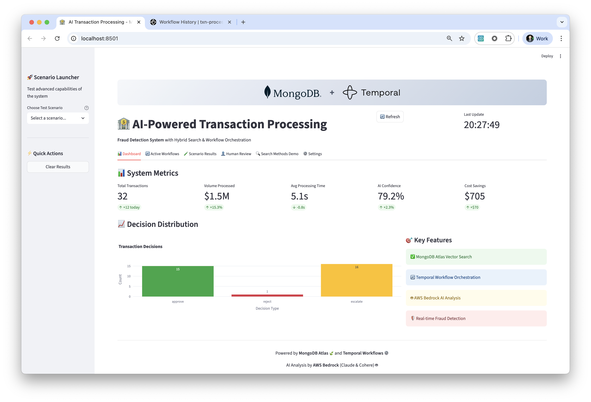
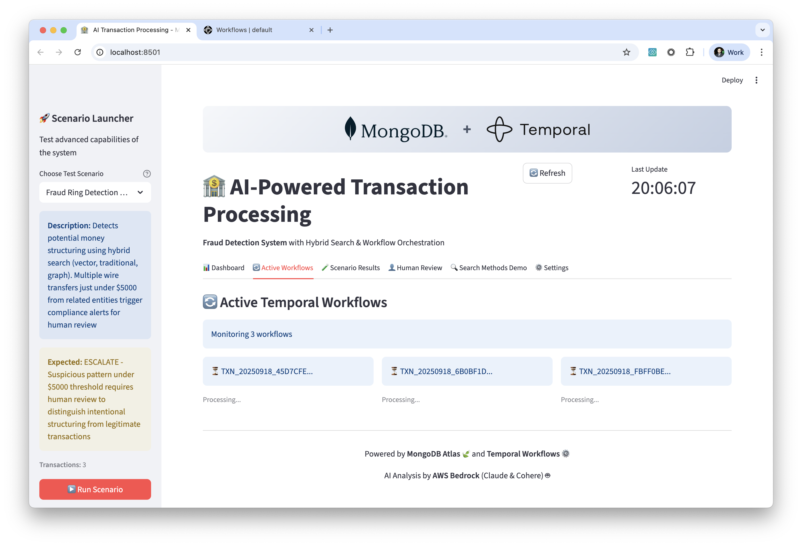
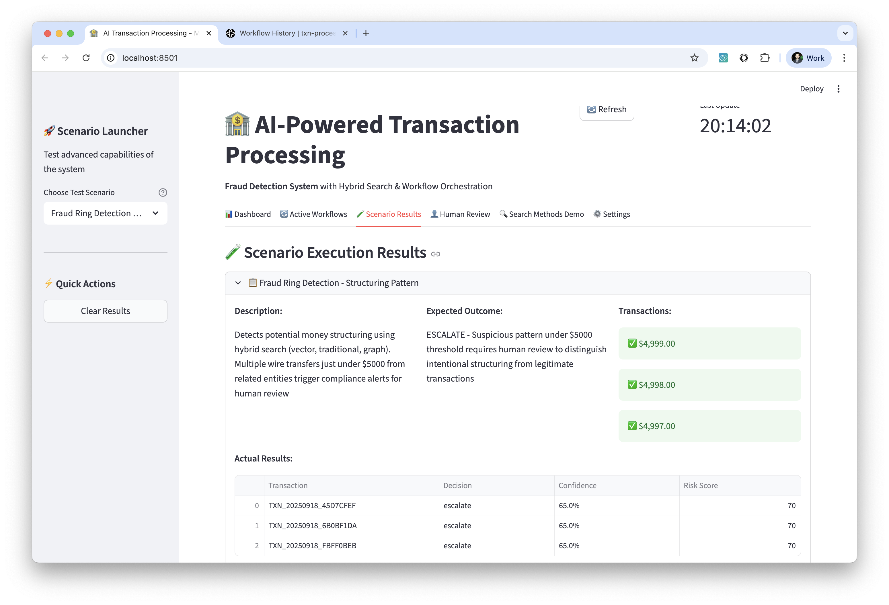
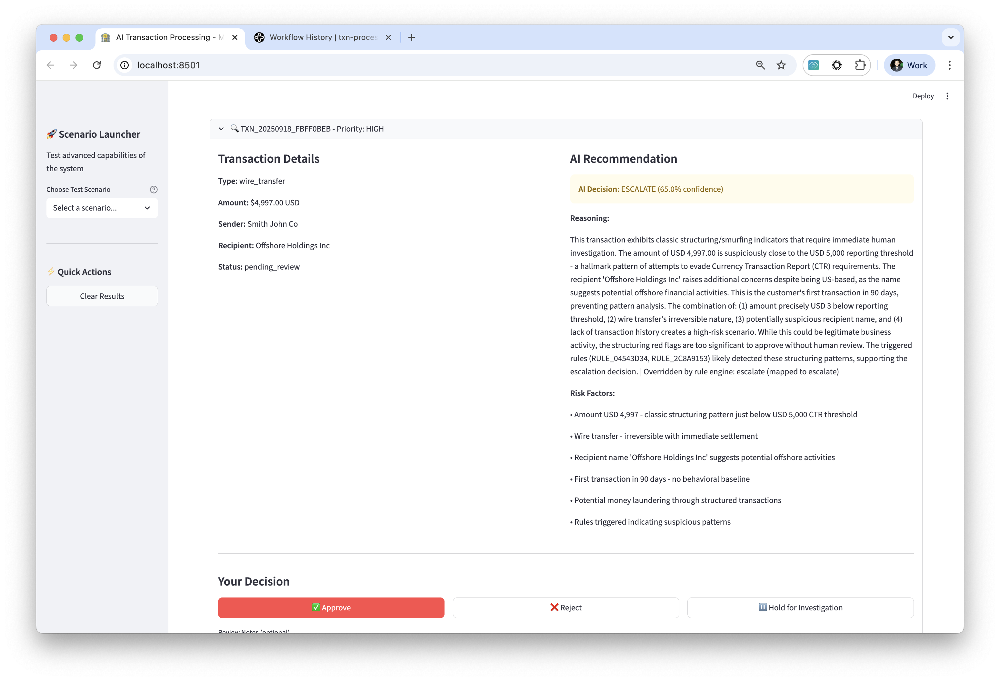
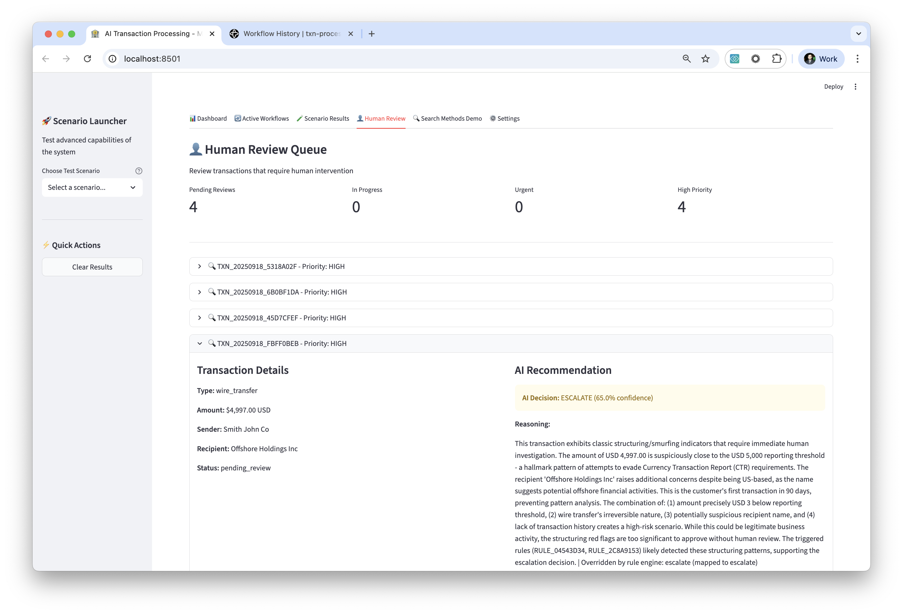
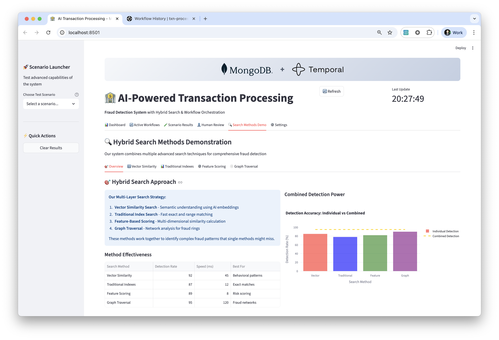
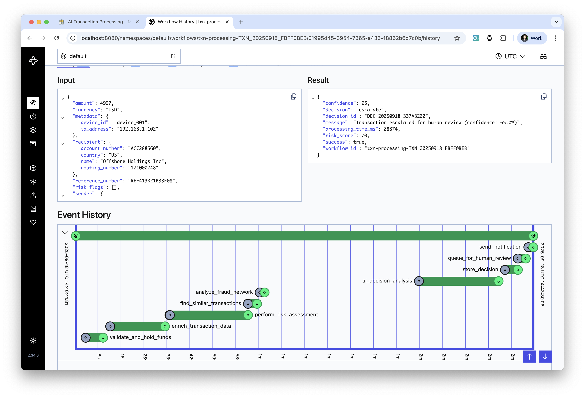
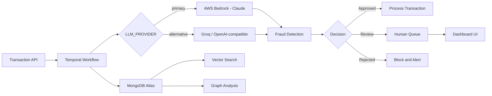

<div align="center">


<br />
<br />

# Fraud Detection Agent with Temporal and Okahu

### Temporal and MongoDB fraud agent with Monocle traces and Okahu evals

A transaction fraud-detection system built on Temporal workflows, MongoDB Atlas vector search and an LLM, extended with Monocle tracing and Okahu-graded evals and an OpenAI-compatible provider such as Nebius.

<br />

[![Built by Studio1](https://img.shields.io/badge/Built_by_Studio1-f97316?style=for-the-badge&logo=data%3Aimage%2Fsvg%2Bxml%3Bbase64%2CPHN2ZyB4bWxucz0iaHR0cDovL3d3dy53My5vcmcvMjAwMC9zdmciIHZpZXdCb3g9IjAgMCAxNjAgMTYwIiBmaWxsPSJub25lIj48cGF0aCBmaWxsLXJ1bGU9ImV2ZW5vZGQiIGNsaXAtcnVsZT0iZXZlbm9kZCIgZD0iTTAgMzVDMCAxNi42ODA3IDE0LjA3NDQgMS42NDg0NCAzMiAwLjEyNjk1M1YxNDFINTEuMDUyM0M1Mi40MzA4IDEzNy4zNDQgNTQuNzQ0NiAxMzMuNjg5IDU3Ljk5MzggMTMwLjAzM0M2MS4xNDQ2IDEyNi41MDggNjQuNjg5MiAxMjMuNDQgNjguNjI3NyAxMjAuODI5QzcyLjU2NjIgMTE4LjM0OSA3Ni4zNTY5IDExNi43ODIgODAgMTE2LjEyOVY4Ni43NTQ0Qzc1LjQ3MDggODcuOTI5MiA3MS4zODQ2IDg5LjY5MTkgNjcuNzQxNSA5Mi4wNDE1QzY0IDk0LjUyMjUgNjAuNzUwOCA5Ny40NiA1Ny45OTM4IDEwMC44NTRDNTYuNTM0NSAxMDIuNzIgNTUuMjU0NSAxMDQuNjU5IDU0LjE1MzkgMTA2LjY3MVYwSDEyNUMxNDQuMzMgMCAxNjAgMTUuNjY5OSAxNjAgMzVWMTI1QzE2MCAxNDQuMzMgMTQ0LjMzIDE2MCAxMjUgMTYwSDEyNFYxOEgxMDQuOTQ4QzEwMy41NjkgMjEuNjgxNiAxMDEuMjU1IDI1LjM2MjggOTguMDA2MiAyOS4wNDQ0Qzk0Ljg1NTQgMzIuNTk0MiA5MS4zMTA4IDM1LjY4NDEgODcuMzcyMyAzOC4zMTRDODMuNDMzOCA0MC44MTIgNzkuNjQzMSA0Mi4zODk2IDc2IDQzLjA0NzRWNzIuNjMwNEM4MC41MjkyIDcxLjQ0NzMgODQuNjE1NCA2OS42NzI0IDg4LjI1ODUgNjcuMzA1N0M5MiA2NC44MDc2IDk1LjI0OTIgNjEuODQ5MSA5OC4wMDYyIDU4LjQzMDdDOTkuNDY1NSA1Ni41NTEzIDEwMC43NDUgNTQuNTk4NiAxMDEuODQ2IDUyLjU3MjNWMTYwSDM1QzE1LjY3IDE2MCAwIDE0NC4zMyAwIDEyNVYzNVoiIGZpbGw9IiNmZmZmZmYiLz48L3N2Zz4K)](https://studio1hq.com)
[](https://okahu.ai)

[Okahu docs](https://docs.okahu.ai) &nbsp;·&nbsp; [Okahu](https://okahu.ai) &nbsp;·&nbsp; [Temporal](https://temporal.io) &nbsp;·&nbsp; [MongoDB](https://mongodb.com) &nbsp;·&nbsp; [Nebius](https://nebius.com) &nbsp;·&nbsp; [More examples](https://github.com/Studio1HQ) &nbsp;·&nbsp; [studio1hq.com](https://studio1hq.com)

</div>

<br />

## Overview

This is an AI-powered transaction processing system. A FastAPI service starts a [Temporal](https://temporal.io) workflow for each transaction. The workflow runs rule checks and risk scoring, searches [MongoDB Atlas](https://www.mongodb.com/docs/atlas/) for similar past transactions with vector search, and asks an LLM for an approve, review or reject decision with written reasoning. Borderline cases go to a human review queue shown in a Streamlit dashboard.

It is a fork of the MongoDB Temporal AI agent sample (`mongodb-partners/mongodb-temporal-ai-agent-qs`) with an observability and evaluation loop added. [Monocle](https://github.com/monocle2ai/monocle) instruments the app, traces are recorded per scenario, and [Okahu](https://okahu.ai) grades them for hallucination, PII, bias and whether the reasoning is grounded in tool output.

<p align="center"></p>

<details>
<summary>More screenshots</summary>

<p align="center"></p>
<p align="center"></p>
<p align="center"></p>
<p align="center"></p>
<p align="center"></p>
<p align="center"></p>

</details>

## Features

- **Durable workflows**: Temporal handles retries and keeps a full execution history. A worker killed mid-transaction picks the work up again after a restart.
- **Hybrid search**: MongoDB Atlas vector search finds similar transactions, with a rule-based fallback when `$vectorSearch` is unavailable.
- **Explainable decisions**: the LLM returns a decision, confidence and reasoning. Thresholds are configurable (auto-approve at 85 confidence by default, manager approval above 50,000 USD).
- **Human review queue**: escalated transactions appear in the dashboard for approve or reject with comments.
- **Pluggable LLM and embeddings**: `LLM_PROVIDER` selects `bedrock`, `groq` or `openai` (any OpenAI-compatible endpoint, including Nebius Token Factory). Embeddings use Voyage, Cohere via Bedrock, or OpenAI-compatible models.
- **Monocle tracing**: one `import monocle_bootstrap` line per entrypoint wraps the LLM client, rule engine, risk engine, embedding client and three Temporal activities.
- **Okahu evals**: recorded traces are graded for hallucination, PII, bias and a custom "grounded fraud reasoning" template.
- **Test suite**: 430+ unit and integration tests with a coverage gate of 95%.

## Tech stack

| Layer | Tool |
| --- | --- |
| Orchestration | [Temporal](https://temporal.io) |
| Database | [MongoDB Atlas](https://www.mongodb.com/docs/atlas/) with vector search |
| API | [FastAPI](https://fastapi.tiangolo.com) |
| Dashboard | [Streamlit](https://streamlit.io) |
| LLM | [AWS Bedrock](https://aws.amazon.com/bedrock/) (Claude), [Groq](https://groq.com), or any OpenAI-compatible endpoint such as [Nebius Token Factory](https://docs.tokenfactory.nebius.com) |
| Embeddings | [Voyage AI](https://www.voyageai.com), Cohere via Bedrock, or OpenAI-compatible |
| Observability and evals | [Monocle](https://github.com/monocle2ai/monocle) and [Okahu](https://okahu.ai) |
| Packaging | [uv](https://docs.astral.sh/uv/), Docker Compose |

## Getting started

### Prerequisites

- Python 3.13 or later
- [uv](https://docs.astral.sh/uv/)
- Docker and Docker Compose
- A MongoDB Atlas account (free tier works)
- An LLM provider: AWS Bedrock access, a Groq key, or an OpenAI-compatible endpoint key
- A Voyage AI key for embeddings (recommended), or use the OpenAI-compatible embedding option
- An Okahu API key from [portal.okahu.co](https://portal.okahu.co) for the evals (optional)
- 8 GB of RAM

### Installation

```bash
git clone https://github.com/Studio1HQ/temporal-ai-mongo.git
cd temporal-ai-mongo
cp .env.example .env
uv sync --extra dev
```

Use `uv sync --frozen` for a reproducible install from `uv.lock`.

### Environment variables

Edit `.env`. See `.env.example` and [docs/CONFIGURATION.md](docs/CONFIGURATION.md) for the full list.

| Variable | Description |
| --- | --- |
| `MONGODB_URI` | MongoDB connection string. Atlas, or `mongodb://localhost:27017/?directConnection=true` locally. |
| `MONGODB_DB_NAME` | Database name. Default `transaction_ai_poc`. |
| `TEMPORAL_HOST` | Temporal address. Default `localhost:7233`, or `temporal:7233` under Docker. |
| `TEMPORAL_NAMESPACE`, `TEMPORAL_TASK_QUEUE` | Namespace (`default`) and queue (`transaction-processing-queue`). |
| `LLM_PROVIDER` | `bedrock` (default), `groq` or `openai`. |
| `AWS_REGION`, `AWS_ACCESS_KEY_ID`, `AWS_SECRET_ACCESS_KEY` | Required for Bedrock. |
| `BEDROCK_MODEL_VERSION` | Bedrock Claude model ID. |
| `GROQ_API_KEY`, `GROQ_MODEL_ID` | Used when `LLM_PROVIDER=groq`. |
| `OPENAI_API_KEY`, `OPENAI_BASE_URL`, `OPENAI_MODEL` | Used when `LLM_PROVIDER=openai`. For Nebius: base URL `https://api.tokenfactory.nebius.com/v1/`, model `meta-llama/Llama-3.3-70B-Instruct`. |
| `EMBEDDING_PROVIDER`, `OPENAI_EMBEDDING_MODEL`, `VECTOR_DIMENSION` | Set `EMBEDDING_PROVIDER=openai`, for example `Qwen/Qwen3-Embedding-8B` with `VECTOR_DIMENSION=4096`. |
| `VOYAGE_API_KEY`, `VOYAGE_MODEL` | Voyage embeddings (default model `voyage-4`, 1024 dimensions). |
| `CONFIDENCE_THRESHOLD_APPROVE`, `CONFIDENCE_THRESHOLD_ESCALATE` | Confidence cut-offs (85 and 70). |
| `AUTO_APPROVAL_LIMIT` | Maximum amount before manager approval, in USD. Default 50000. |
| `OKAHU_API_KEY`, `OKAHU_APP_ID`, `MONOCLE_EXPORTER` | Okahu tracing, for example `MONOCLE_EXPORTER=file,okahu`. |
| `API_BASE_URL` | `http://localhost:8000/api` locally, `http://api:8000/api` under Docker. |

### Run

Quick setup scripts:

```bash
./scripts/quick_setup.sh    # venv, deps, Temporal on Docker, then launch the app
./scripts/docker_setup.sh   # everything on Docker
```

Or run each piece yourself. Start Temporal, seed MongoDB, then start three processes:

```bash
cd docker-compose && docker compose up -d && cd ..
uv run python -m scripts.setup_mongodb      # collections, indexes, vector index, seed data

uv run python -m temporal.run_worker        # terminal 1: worker
uv run uvicorn api.main:app --reload        # terminal 2: API
uv run streamlit run app.py                 # terminal 3: dashboard
```

| Service | URL |
| --- | --- |
| Streamlit dashboard | <http://localhost:8501> |
| API docs | <http://localhost:8000/docs> |
| Temporal UI | <http://localhost:8080> |

Docker option: start Temporal with `cd docker-compose && docker compose up -d`, then `docker compose up -d` for the API, worker and dashboard. Check with `curl http://localhost:8000/health`.

Submit a transaction:

```bash
curl -X POST 'http://localhost:8000/api/transaction' \
  -H 'Content-Type: application/json' \
  -d '{
  "transaction_type": "wire_transfer",
  "amount": 100,
  "currency": "USD",
  "sender": {"account_number": "ACC-12345", "country": "US", "name": "Sam Eagleton"},
  "recipient": {"account_number": "ACC-67890", "country": "UK", "name": "Nigel Wadsworth"},
  "reference_number": "95027064"
}'

# Poll until it returns 200 instead of 202 (pending)
curl http://localhost:8000/api/transaction/<transaction_id>
```

Run the high-value scenario, which lands in the "Pending Manager Approval" queue:

```bash
uv run python -m scripts.advanced_scenarios
```

### Run the eval loop

```bash
export LLM_PROVIDER=openai
export EMBEDDING_PROVIDER=openai
export MONOCLE_EXPORTER=file,okahu
export OKAHU_API_KEY=okh_...
export OKAHU_APP_ID=mongodb-fraud-agent_<six-chars>   # from portal.okahu.co

uv run python -m scripts.setup_mongodb
uv run python -m temporal.run_worker &
uv run uvicorn api.main:app --port 8010 &
uv run python -m evals.record_from_scenarios   # 5 real scenarios end to end
uv run python -m evals.submit_evals            # graded evals sent to Okahu
```

Verdicts appear in the Okahu portal, the VS Code Okahu extension and Kahu Chat. Ask Kahu for a root-cause analysis, apply the fix and re-run.

Known constraint: the `mongodb-atlas-local` Docker image does not expose `$vectorSearch` without an Atlas CLI local deployment. `find_similar_transactions` then falls back to traditional search. Point `MONGODB_URI` at an Atlas cluster for full vector search.

### Tests

```bash
uv run pytest --cov                                                              # full suite, 95% gate
uv run pytest tests/test_decimal_utils.py tests/test_rule_engine.py tests/test_risk_engine.py   # fast unit tests
uv run pytest tests/test_db_integration.py tests/test_api_integration.py         # needs Docker
```

## How it works



```text
api/                FastAPI endpoints
temporal/           workflows, activities, worker
services/           rule_engine.py, risk_engine.py
ai/                 bedrock, groq, openai clients, embeddings, prompts
database/           repositories and schemas
monocle_bootstrap.py  Monocle wrappers, imported by api/main.py and run_worker.py
evals/              record_from_scenarios.py, submit_evals.py, templates/, traces/
```

The original proof of value covers fraud ring detection, real-time risk scoring, sanctions-style compliance checks and human-in-the-loop escalation. Scope limits: mock data only, single region, no throughput tuning, a basic notification system and simplified compliance checks. This is a reference implementation, not production code.

Evaluation flows to try: a low-risk domestic transaction under 5,000 USD approves automatically; a velocity scenario shows AI reasoning and similar-transaction matches; a medium-confidence transaction goes to the review queue; a transaction over 50,000 USD escalates to a manager; and killing the worker mid-transaction still completes after a restart. See [docs/EVALUATION_GUIDE.md](docs/EVALUATION_GUIDE.md).

| Problem | Fix |
| --- | --- |
| MongoDB connection failed | Check the URI and the Atlas IP allow list. |
| Bedrock timeouts | Make sure AWS keys are in `.env`. |
| Worker not processing | Run `docker compose up -d` in `docker-compose/`. |
| Dashboard blank | Check the API is running on port 8000. |
| Vector search returns nothing | Run `uv run python -m scripts.setup_mongodb`. |

## Resources

- [docs/ARCHITECTURE.md](docs/ARCHITECTURE.md), [docs/CONFIGURATION.md](docs/CONFIGURATION.md), [docs/EVALUATION_GUIDE.md](docs/EVALUATION_GUIDE.md), [docs/UI_GUIDE.md](docs/UI_GUIDE.md), [docs/TROUBLESHOOTING.md](docs/TROUBLESHOOTING.md): detailed guides in this repo.
- [Okahu docs](https://docs.okahu.ai) and [site](https://okahu.ai): observability and evals.
- [Monocle](https://github.com/monocle2ai/monocle): open-source tracing for agentic apps.
- [Temporal docs](https://docs.temporal.io) and [site](https://temporal.io): workflow orchestration.
- [MongoDB Atlas docs](https://www.mongodb.com/docs/atlas/): vector search and clusters.
- [Nebius Token Factory docs](https://docs.tokenfactory.nebius.com): OpenAI-compatible inference.
- [mongodb-temporal-ai-agent-qs](https://github.com/mongodb-partners/mongodb-temporal-ai-agent-qs): the upstream sample this repo forks.

## License

Released under the [Apache License 2.0](LICENSE).

<br />

---

<div align="center">

<a href="https://studio1hq.com">
  <picture>
    <source media="(prefers-color-scheme: dark)" srcset="https://raw.githubusercontent.com/Studio1HQ/website/main/brand/studio1-logo-on-dark.svg" />
    
  </picture>
</a>

Built by **[Studio1](https://studio1hq.com)**, the technical content and DevRel partner for devtool teams. Made with [Okahu](https://okahu.ai).<br />
Browse more open-source examples at [github.com/Studio1HQ](https://github.com/Studio1HQ).

[](https://studio1hq.com)
[](https://cal.com/studio1/collab)
[](https://x.com/Studio1HQ)
[](https://www.linkedin.com/company/studio1hq/)

<sub><a href="https://studio1hq.com">studio1hq.com</a> · Technical content, docs, video and DevRel for devtools</sub>

</div>
